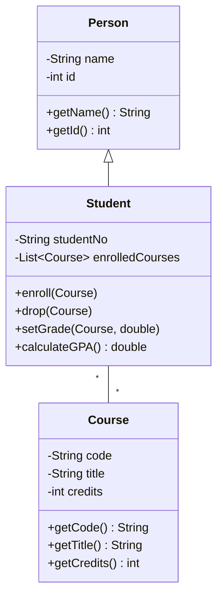

# Student Class Diagram

Java implementation of the student class diagram.

## Classes
- `Person` (name, id): base class
- `Student` extends `Person` (studentNo, enrolledCourses, grades): `enroll()`, `drop()`, `setGrade()`, `calculateGPA()`
- `Course` (code, title, credits)
- `Main`: demo program

## Relationships
- `Student` inherits from `Person`
- `Student` and `Course` have a many-to-many association

## Run
```
javac *.java
java Main
```
## Class Diagram


